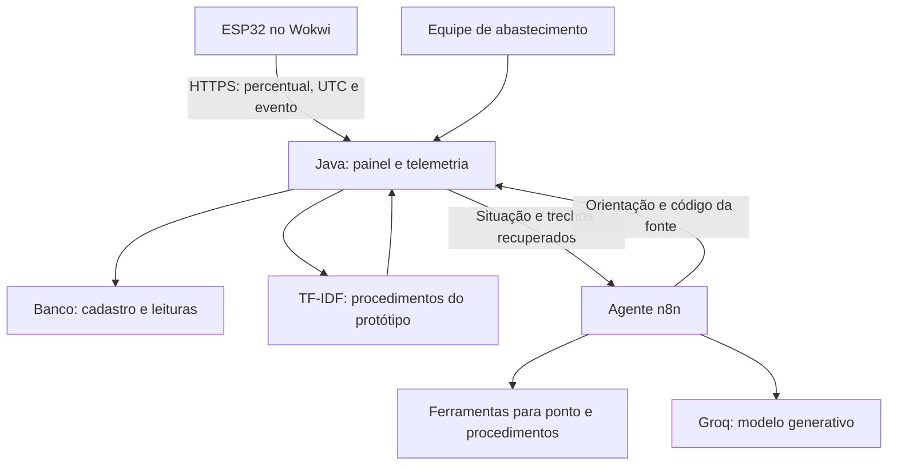

# Nexus Verde · Copiloto de abastecimento
**FIAP · Global Solution 2026/2 · Disruptive Architectures: IoT, IoB & Generative IA · 2TDSPF**

Durante uma interrupção de abastecimento, o estoque cadastrado de um abrigo pode divergir da medição do reservatório. O Nexus Verde mostra à equipe as duas informações, a idade da leitura e uma orientação fundamentada em procedimentos de operação do protótipo. A equipe confere o estoque antes de registrar ajustes.

## Experimentar pelo painel

1. Entre com o acesso de equipe fornecido pela equipe avalianda no [painel público](https://nexus-verde-java-gs2026-2-tprk.onrender.com/painel/pontos-agua).
2. Abra **Abrigo São Geraldo → Ver reservatório → Testar cenário de 5%**. Esse botão gera uma leitura temporária, identificada na tela. Compare o estoque vigente com o volume estimado. Para uma capacidade de 8.000 L, 5% equivale a 400 L.
3. Examine a recomendação, a identificação do motor e o trecho citado. Um erro no modelo aparece como indisponibilidade da orientação. Os valores do ponto continuam visíveis.
4. Para trabalhar com o sensor, abra **Parear circuito Wokwi** e gere uma chave de 30 minutos, específica para o ponto. Em um [projeto ESP32 no Wokwi](https://wokwi.com/projects/new/esp32), substitua `sketch.ino` e `diagram.json` pelos arquivos em `wokwi/`. Inicie e cole no monitor serial a linha gerada pelo painel. Ajuste o potenciômetro. Após HTTP 204, reabra o reservatório, compare o UUID e clique em **Analisar abastecimento**. A expiração exige novo pareamento. O painel aceita nova leitura quando o nível muda.
5. Para demonstrar a mudança de requisito da banca, altere `IOT_VALIDADE_SEGUNDOS` no Java e repita o teste com a medição anterior. O padrão é 900 segundos. Esta é uma convenção acadêmica configurável.

## Arquitetura

A integração e o RAG estão no [código Java](https://github.com/EduMollo/Nexus-Verde-Java-GS2026-2/tree/main/src/main/java/br/com/fiap/nexusverde/iot). O Java carrega um snapshot do ponto, calcula o volume e a diferença assinada, verifica validade e recupera até três trechos por similaridade de cosseno. O agente n8n deve chamar as duas ferramentas antes de responder. A saída é validada e o trecho citado é exibido junto do texto. Sem webhook configurado, o painel usa Spring AI com a mesma base e identifica esse motor na tela.

## Executar localmente

- **Java**. Use JDK 21 e o Maven Wrapper do [repositório Java](https://github.com/EduMollo/Nexus-Verde-Java-GS2026-2). Siga a seção de execução com o perfil `demo` para iniciar H2 com pontos fictícios e configurar a conta de equipe. Execute `./mvnw clean verify` no Linux ou `.\mvnw.cmd clean verify` no PowerShell.
- **Agente**. Na pasta que contém este README, copie `.env.example` para `.env`. Configure uma chave privada da Groq e um valor aleatório de pelo menos 32 caracteres para `IOT_N8N_TOKEN`. Execute `docker compose up --build -d` e aguarde `http://localhost:5679/healthz`. Inicie o Java no host com `IOT_N8N_URL=http://localhost:5679/webhook/abastecimento` e o mesmo `IOT_N8N_TOKEN`. O provedor usa o endpoint compatível com OpenAI da Groq e o modelo `llama-3.3-70b-versatile`. A importação das credenciais e a publicação do workflow são automáticas.
- **Circuito**. O firmware aponta para o Java público por padrão. Para outra instalação, configure a constante `BASE` com um endereço HTTPS alcançável pelo simulador. Para compilar, use `pip install platformio==6.1.18` e `pio run -d wokwi`. O potenciômetro em GPIO 34 representa 0 a 100% do volume útil. O LED em GPIO 25 indica nível de até 15%. O ESP32 utiliza Wi-Fi simulado, sincronização UTC e validação TLS.
- **Testes**. A suíte Java cobre cadastro e ingestão, repetição de eventos, ordem temporal, autorização por ponto, intervalo percentual e RAG. `bash tests/agente.sh` usa Docker, curl e jq para exercitar o workflow com um dublê do protocolo de tool calling. A prova de geração real exige um modelo ativo e uma execução pelo painel.

## Dados, avaliação e limites

Os campos utilizados são identificador do ponto, situação operacional, capacidade, estoque e leitura simulada. O cadastro de demonstração tem origem na [migration Java](https://github.com/EduMollo/Nexus-Verde-Java-GS2026-2/blob/main/src/main/resources/db/demo/V100__cenario_canoas.sql). Os [dados fictícios de Database](https://github.com/EduMollo/Nexus-Verde-Database-GS2026-2/blob/main/dataset/pontos_agua.json) motivam casos como ponto fechado, ponto esgotado e capacidade zero. As duas cargas possuem identificadores independentes. O pareamento usa o ID selecionado no próprio painel.

Os [seis procedimentos acadêmicos](https://github.com/EduMollo/Nexus-Verde-Java-GS2026-2/blob/main/src/main/resources/iot/procedimentos.tsv) são documentos curtos da equipe. Cada linha tem código, título e trecho. A indexação normaliza acentos e caixa, pondera os termos por TF-IDF e ordena por cosseno. Esse método é reproduzível para um corpus pequeno e permite conferir a fonte. Regras determinísticas produzem a consulta operacional a partir do snapshot do ponto. O método lexical pode perder paráfrases sem vocabulário em comum.

| Ensaio | Resultado observado |
|---|---|
| Recuperação lexical em 12 consultas de avaliação | Procedimento correto em primeiro lugar em 11/12 (91,7%). Entre os três primeiros em 12/12 (100%). |
| Diferença de estoque | O teste calcula 400 L estimados e diferença de −800 L para 8.000 L de capacidade, 1.200 L cadastrados e leitura de 5%. |
| Medição antiga, ausente, capacidade zero, ponto fechado ou esgotado | A suíte verifica a consulta operacional aplicável e evita converter capacidade desconhecida em estimativa. |
| Repetição, atraso, percentual inválido e chave revogada | Testes de integração com Spring, H2, Flyway e MockMvc verificam estados e códigos HTTP. |

[Evidências de execução do Java](https://github.com/EduMollo/Nexus-Verde-Java-GS2026-2/actions/runs/44392660355) · [Casos e consultas de recuperação](https://github.com/EduMollo/Nexus-Verde-Java-GS2026-2/blob/main/src/test/java/br/com/fiap/nexusverde/iot/ReservatorioTest.java).

As métricas avaliam a recuperação de procedimentos em exemplos pequenos, construídos pela equipe. A orientação generativa requer revisão humana. Um sensor de nível não mede potabilidade. O modelo recebe dados operacionais fictícios e a saída nunca altera o estoque. Não publique chaves, senhas de avaliação ou sessões de pareamento.

## Apresentação presencial

1. Apresentar o problema do abrigo e abrir o ponto no painel.
2. Alterar o reservatório no Wokwi e conferir UUID, horário e percentual na tela.
3. Gerar a orientação e mostrar o trecho recuperado. Explicar por que o estoque cadastrado continua sob controle humano.
4. Mostrar o agente e suas duas ferramentas, as métricas e o caso de leitura antiga. Explicar como trocar a validade e testar a adaptação.
5. Dividir a exposição entre contexto cidadão, circuito, integração Java, agente/RAG e avaliação.

Os integrantes e RMs constam em [INTEGRANTES.txt](INTEGRANTES.txt). O grupo utilizou ChatGPT/Codex em planejamento, implementação, elaboração dos testes e documentação.

O arquivo `wokwi/cenario.yaml` também exercita o circuito em dois níveis, sem pareamento. Com o Wokwi CLI configurado, execute `wokwi-cli . --scenario cenario.yaml --timeout 20000` dentro de `wokwi/` após compilar. O monitor serial permite observar o nível e o LED antes de transmitir.
